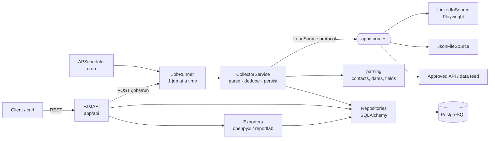

# LinkedIn Job Lead Collector

Backend service that helps **one job seeker** collect *publicly visible* recruiter contact details from recent
"Python Developer" posts, store them in PostgreSQL, and export them to Excel/PDF for **manual** follow-up.
It never sends messages, connection requests or e-mails.

## Read this first: compliance
* LinkedIn's User Agreement prohibits automated scraping, including with a logged-in account, and its
  `robots.txt` disallows crawling. Using the `linkedin` source can lead to account restrictions. You run it at your own risk.
* The tool is built to be conservative: normal login only, a persisted session, jittered delays, small scroll/post caps,
  retries only on timeouts/network errors, and a **hard stop** (job status `NEEDS_MANUAL_ACTION`) on CAPTCHA/MFA/checkpoints.
  There is no stealth, fingerprint spoofing, proxy rotation or CAPTCHA solving, and there will not be.
* Prefer an approved source where one exists. The browser layer sits behind a `LeadSource` interface (below), so
  swapping it requires no change to business logic. `LEAD_SOURCE=json_file` is included as a second implementation.
* The data is personal data (names, e-mails, phones). Keep it private, use it only to apply for jobs, delete what you no longer need
  (DPDP Act / GDPR principles apply), and protect `data/` (session cookies and screenshots live there).

## Architecture

Only `app/sources/*` knows about LinkedIn. `CollectorService` consumes `RawPost` objects from anything implementing:
```python
class LeadSource(Protocol):
    name: str
    def fetch_posts(self, criteria: SearchCriteria) -> Iterator[RawPost]: ...
```
To add a provider: implement it, register it in `app/sources/__init__.py::build_source`, set `LEAD_SOURCE`.

## Folder structure
```
linkedin-job-lead-collector/
├── app/
│   ├── main.py              # app factory, lifespan, DI
│   ├── config.py            # pydantic-settings (.env)
│   ├── domain.py            # SearchCriteria, TimeFilter
│   ├── logging_config.py    # JSON logs + job_id correlation
│   ├── cli.py               # login / run / init-db
│   ├── api/                 # routes, schemas, deps (API-key auth)
│   ├── sources/             # base protocol, errors, json_file, linkedin/{browser,auth,search,guards,selectors}
│   ├── parsing/             # contacts (email/phone), dates, post_parser, models
│   ├── services/            # collector, job_runner, scheduler
│   ├── db/                  # base, models, session, repositories
│   ├── exporters/           # common, excel, pdf
│   └── utils/               # retry, rate_limit, urls
├── tests/                   # 65 tests (SQLite in-memory; no browser needed)
├── data/                    # session file + screenshots (git-ignored)
├── Dockerfile  docker-compose.yml  requirements*.txt  .env.example  pytest.ini
```

## Database schema
```sql
CREATE TABLE jobs (
  id UUID PRIMARY KEY,
  status VARCHAR(32) NOT NULL,            -- QUEUED|RUNNING|SUCCEEDED|FAILED|NEEDS_MANUAL_ACTION
  keyword VARCHAR(100) NOT NULL, location VARCHAR(100) NOT NULL,
  time_filter VARCHAR(20) NOT NULL, max_posts INTEGER NOT NULL,
  posts_seen INTEGER NOT NULL DEFAULT 0, new_leads INTEGER NOT NULL DEFAULT 0,
  duplicate_posts INTEGER NOT NULL DEFAULT 0, skipped_posts INTEGER NOT NULL DEFAULT 0,
  emails_found INTEGER NOT NULL DEFAULT 0, phones_found INTEGER NOT NULL DEFAULT 0,
  error_code VARCHAR(64), error_message TEXT, screenshot_path VARCHAR(512),
  created_at TIMESTAMPTZ NOT NULL, started_at TIMESTAMPTZ, finished_at TIMESTAMPTZ
);
CREATE INDEX ix_jobs_status ON jobs(status);

CREATE TABLE leads (
  id SERIAL PRIMARY KEY,
  author_name VARCHAR(255), profile_url VARCHAR(1024), company VARCHAR(255),
  job_title VARCHAR(255), location VARCHAR(255),
  post_url VARCHAR(1024) NOT NULL UNIQUE,   -- normalised; the dedup key
  post_date TIMESTAMPTZ, email VARCHAR(512), phone VARCHAR(255), post_text TEXT,
  collected_at TIMESTAMPTZ NOT NULL,
  job_id UUID REFERENCES jobs(id) ON DELETE SET NULL
);
CREATE INDEX ix_leads_post_date ON leads(post_date);
CREATE INDEX ix_leads_collected_at ON leads(collected_at);
```
Tables are created at startup (`create_all`). For schema changes in production, add Alembic.
If a post lists several contacts they are stored joined with `"; "`.

## Setup (local)
```bash
python3.11 -m venv .venv && source .venv/bin/activate
pip install -r requirements-dev.txt
playwright install chromium
cp .env.example .env            # edit DATABASE_URL, API_KEY, ...
docker compose up -d db         # PostgreSQL on 127.0.0.1:5432 (credentials come from POSTGRES_* in .env)
# No Docker? Use SQLite for local trials: DATABASE_URL=sqlite+pysqlite:///data/leads.db
python -m app.cli login         # one-time: sign in yourself in the opened browser (handles CAPTCHA/MFA)
uvicorn app.main:app --port 8000 --workers 1
```
Try it without LinkedIn first: `LEAD_SOURCE=json_file JSON_SOURCE_PATH=data/sample_posts.json`.
One-off run from the shell: `python -m app.cli run --time-filter past_week --max-posts 30`.
Tests: `pytest`. Interactive docs: http://localhost:8000/docs

## Docker
```bash
cp .env.example .env            # set POSTGRES_PASSWORD, API_KEY (and keep DATABASE_URL consistent)
python -m app.cli login         # on the host, once; writes data/linkedin_state.json (mounted into the container)
docker compose up --build -d
curl localhost:8000/health
```
`./data` is mounted at `/app/data`; the container user is UID 10001, so `chmod -R a+rwX data` (or `chown 10001 data`) if writes fail.
The container is headless, so it cannot complete CAPTCHA/MFA; when the saved session expires, repeat `login` on the host.

## API
All endpoints except `/health` require `X-API-Key` when `API_KEY` is set.

| Method | Path | Notes |
|---|---|---|
| POST | `/jobs/run` | 202 + job; 409 if one is already running |
| GET | `/jobs/{job_id}` | status and counters |
| GET | `/leads` | filters: `has_email, has_phone, company, q, since, job_id, limit, offset` |
| GET | `/leads/export/excel` | same filters; `.xlsx` with all fields + Summary sheet |
| GET | `/leads/export/pdf` | same filters; summary + lead details |
| GET | `/health` | 200 / 503 (DB check) |

```bash
curl -X POST localhost:8000/jobs/run -H "X-API-Key: $API_KEY" -H "Content-Type: application/json" \
  -d '{"keyword":"Python Developer","location":"Pune, India","time_filter":"past_24h","max_posts":50}'
```
```json
{"job_id":"6e4c91ae-252d-4210-9511-10ca368c00f8","status":"QUEUED","keyword":"Python Developer","location":"Pune, India",
 "time_filter":"past_24h","max_posts":50,"posts_seen":0,"new_leads":0,"duplicate_posts":0,"skipped_posts":0,
 "emails_found":0,"phones_found":0,"error_code":null,"error_message":null,
 "created_at":"2026-10-07T04:58:35Z","started_at":null,"finished_at":null}
```
`GET /jobs/6e4c91ae-...` when a CAPTCHA appears:
```json
{"status":"NEEDS_MANUAL_ACTION","error_code":"challenge_required",
 "error_message":"LinkedIn requested human verification (CAPTCHA/verification element). Resolve it manually with `python -m app.cli login`, then re-run. ...","new_leads":3}
```
`GET /leads?has_email=true&limit=1`:
```json
{"total":1,"limit":1,"offset":0,"items":[{"id":1,"author_name":"Asha Rao","profile_url":"https://www.linkedin.com/in/asha-rao",
 "company":"Acme Tech","job_title":"Python Developer","location":"Pune","post_url":"https://www.linkedin.com/feed/update/urn:li:activity:7000.../",
 "post_date":"2026-10-07T02:58:00Z","email":"jobs@acme.io","phone":"+919876543210","post_text":"...","collected_at":"2026-10-07T04:58:36Z"}]}
```
Downloads: `curl -OJ -H "X-API-Key: $API_KEY" "localhost:8000/leads/export/excel?has_email=true"`.

## Behaviour notes
* **Contact extraction**: only what is literally written. E-mails: strict regex + validation (length, placeholders, file names, no-reply), bracket
  obfuscation `[at]`/`(dot)` normalised. Phones: `phonenumbers` (region IN, valid numbers only) and only when prefixed with `+` or next to a contact cue
  ("call", "WhatsApp", "contact"...). Output in E.164. Nothing is guessed from names.
* **Dates**: post date comes from the post-id timestamp in the URL, else the relative label ("2h"). Posts outside the window are dropped.
* **Dedup**: normalised post URL, unique constraint + `ON CONFLICT DO NOTHING` (safe across runs and processes).
* **Failures**: login failure, CAPTCHA/MFA, timeout, network, layout change and missing contacts are each handled separately (`error_code`:
  `login_failed`, `challenge_required`, `timeout`, `network_error`, `layout_changed`). Browser failures save a screenshot to `SCREENSHOT_DIR`.
  Partial results are kept. Only timeouts/network errors are retried (exponential backoff + jitter).
* **Logs**: JSON, with `job_id`; counts only, never post text, e-mails, phones or credentials.
* **Scheduler**: `SCHEDULER_ENABLED=true` runs the configured cron in-process; use a single API worker. Move to Celery only if you need multiple workers.
* **When LinkedIn changes its markup**: edit `app/sources/linkedin/selectors.py` only. Expect to do this periodically.
* Limits: a few hundred posts per run is the intended scale; PDF default cap is 500 leads; PDF uses a Latin-1 font so emoji are dropped there (Excel keeps them).

for download db in excel 
python dump_to_excel.py

for run main file collect lead
python -m app.cli run --keyword "Python Developer" --location "Pune" --time-filter past_week --max-posts 50

send email
agency-outreach email

send whatsapp
agency-outreach whatsapp --open
